# 운명공방 2099 · 사주 & 부적 프로토타입

생년월일을 넣으면 사주를 분석하고, 오늘의 운세와 오행 기반 부적·행운 이모티콘을 만들어 주는 웹 프로토타입입니다.
설치나 빌드 없이 정적 파일만으로 동작합니다. 기획서는 [`../docs/saju-app-plan.md`](../docs/saju-app-plan.md)에 있습니다.

## 기능

| 탭 | 내용 |
|---|---|
| 입력 | 성별, 지금 가장 큰 고민(시험·취업·재물·사업·연애·결혼·건강·인간관계·이직/이사), 양력·음력 선택, 윤달 자동 표시(그 해 윤달이 있는 달만), 입력 즉시 반대 달력 날짜 미리보기 |
| 사주 분석 | 절기 기준 사주 8글자, 십신, 오행 레이더 차트, 신강/신약, 용신, 일간별 기질 |
| 오늘의 운세 | 고민 맞춤 운세 카드, 오늘 일진 × 내 사주로 6개 분야 점수, 행운 키트(색·숫자·방향·음식·시간), 액땜 미션 |
| 캐릭터 | 띠(12지신) × 일간 오행(한복 색) × 성별(한복 모양) × 고민(소품)으로 만드는 수호 캐릭터(216가지 조합), 부적 2칸·이모티콘 1칸 장착, 장착에 따라 행운력·고민 운 상승 |
| 성장·진화 | 진화 5단계(아기→견습→수호 무사/선녀→수호신→신수, 단계별 몸 크기·배경 무대·장비·애니메이션, 슬롯·능력치 해금), 일일 퀘스트 6종(하루 최대 80 EXP), 연속 출석·보호 부적·연속 보상, 다음 단계 실루엣, 진화 연출 |
| 띠별 성격·말투 | 12띠마다 성격 유형·키워드·말버릇(찍!, 어흥!, 깡총! …)·자기 호칭, 상황별 대사(인사·점수·최고 운·미션·장착·진화·터치·오랜만·궁합), 진화 단계별 말투(아기 "뀨!", 신수 ✦), 캐릭터 터치 반응, 스토리 카드 한마디 |
| 띠끼리 대화 | 144개 띠 조합 전용 대사: 전설의 조합 20쌍(십이지 경주의 쥐와 소, 닭 쫓던 개 등) 주고받는 대화 + 관계(같은 띠·삼합·육합·충·원진·평이)별 띠 말투 대사, 받침에 맞춘 조사 자동 처리, 궁합 결과 대화, 12띠 관계도, 궁합 스토리 카드 대화 |
| 친구 궁합 | 친구 생일만으로 친구 캐릭터 생성, 띠(삼합·육합·충·원진)·일간(천간합·상생·상극)·오행 보완·오늘 기운으로 점수, 등급 5종별 두 캐릭터 포즈, 연애·우정·일 궁합, 인연 부적, 스토리 카드 |
| 부적 공방 | 6종 부적 × 전통/네온 테마, 등급(확률 공개), 효과 수치 공식, 다시 뽑기, 도감, PNG 저장 |
| 행운 이모티콘 | 수호 캐릭터 스티커(흰 테두리·굵은 캡션), 표정 8종 세트, 네온 배경/투명 스티커, PNG 저장 |
| 스토리 공유 | 인스타 스토리 규격(1080×1920) 카드 3종(운세·부적·수호 캐릭터), 휴대폰 공유 시트로 바로 공유, 이미지 저장, 링크 복사 |

액땜 미션을 완료하면 액막이 부적이 "정화"되어 등급이 한 단계 오릅니다.

## 실행

ES 모듈을 쓰기 때문에 파일을 더블클릭하지 말고 간단한 서버로 열어야 합니다.

```bash
cd saju-app && python3 -m http.server 8000
```

브라우저에서 `http://localhost:8000` 을 엽니다. GitHub Pages로 배포하면 `/saju-app/` 경로에서 바로 동작합니다.

## 테스트

```bash
cd saju-app && npm test
```

## 구조

```
saju-app/
├── index.html, styles.css
├── js/
│   ├── saju.js      # 만세력(태양 황경으로 절기 판정), 사주 8글자, 오행, 신강/신약, 십신
│   ├── lunar.js     # 한국 음력: 합삭(Meeus) + 중기 + 무중치윤법, 양력↔음력 변환
│   ├── fortune.js   # 오늘의 운세 점수 공식, 문장, 행운 키트, 미션
│   ├── talisman.js  # 부적 등급/효과 공식, SVG 렌더러(전통·네온), PNG 내보내기
│   ├── character.js # 12지신 수호 캐릭터 SVG, 진화 단계 외형, 장착, 스탯
│   ├── personality.js # 12띠 성격·말투·상황별 대사
│   ├── pairtalk.js  # 띠끼리 만났을 때 대사 (144 조합)
│   ├── compat.js    # 친구 궁합 점수와 2인 카드 SVG
│   ├── growth.js    # 경험치·레벨·진화·퀘스트·연속 출석 (순수 로직)
│   ├── emoticon.js  # 캐릭터 스티커 이모티콘
│   ├── story.js     # 인스타 스토리 카드(캔버스) + Web Share API 공유
│   └── app.js       # 화면과 상태 (localStorage 저장)
└── tests/           # node 테스트
```

## 프로토타입의 한계

- 음력은 한국천문연구원과 같은 원리(한국 표준시 기준 합삭·중기, 무중치윤법)로 직접 계산합니다.
  설날·추석·윤달 날짜로 검증했고, 1901~2099년 모든 날짜의 양력↔음력 왕복을 테스트합니다.
  합삭이나 중기가 자정 몇 분 전후에 걸리는 드문 날은 공식 달력과 하루 차이가 날 수 있습니다.
- 한국 표준시 변경(1908~1911, 1954~1961년의 UTC+8:30)은 반영, 과거 서머타임(1948~1960, 1987~1988)은 미반영
- 절기 시각 오차 약 ±15분
- 신강/신약과 용신은 점수제 간이 판정
- 개인 정보는 브라우저(localStorage)에만 저장되고 서버로 보내지 않음

## 화면 미리보기

| 음력 입력 | 사주 분석 | 오늘의 운세 | 네온 부적 | 전통 부적 | 행운 이모티콘 |
|---|---|---|---|---|---|
| 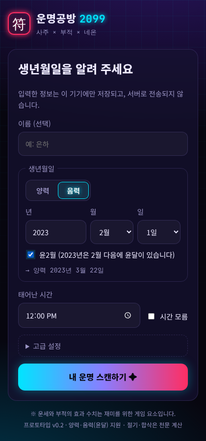 | 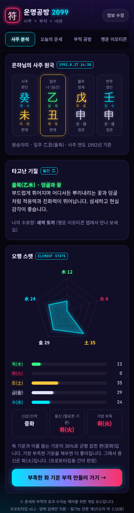 | 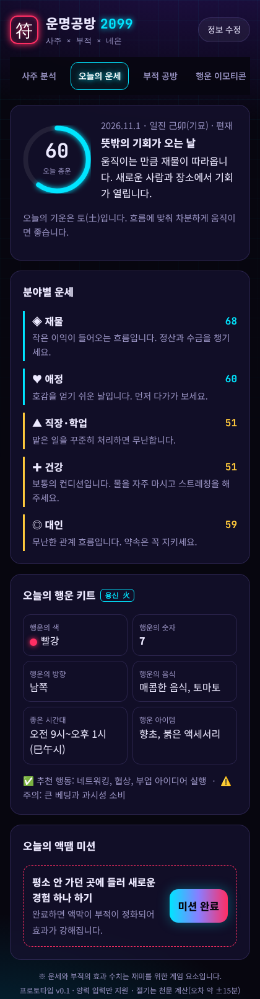 | 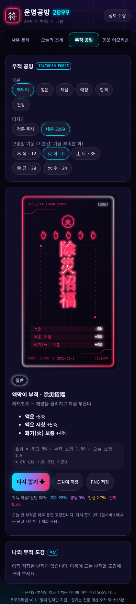 | 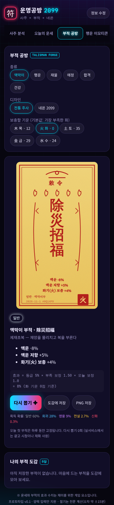 | 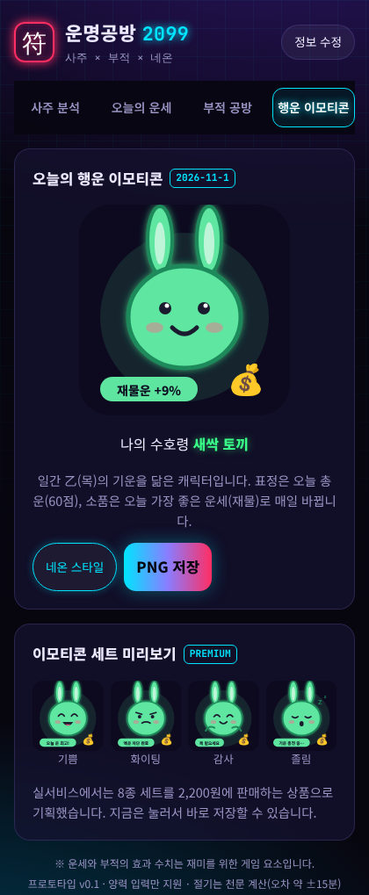 |

### 인스타 스토리 카드

| 오늘의 운세 | 오늘의 부적 | 수호 캐릭터 |
|---|---|---|
| 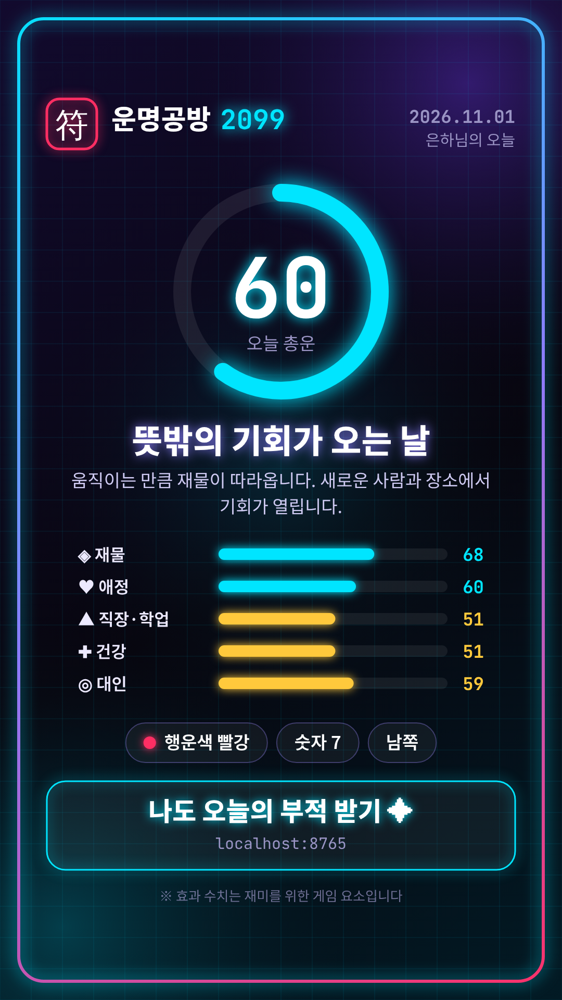 | 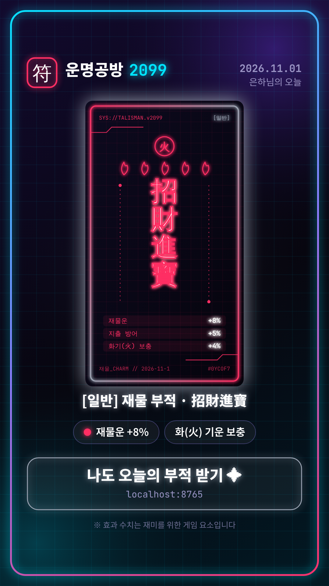 | 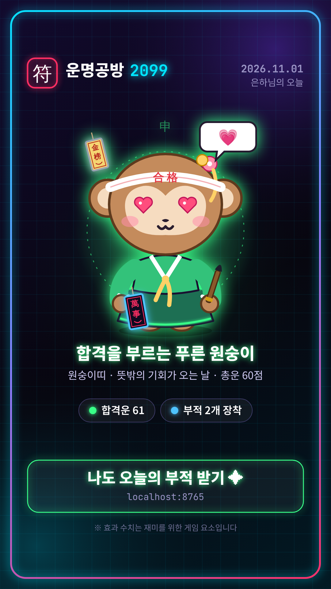 |

휴대폰 브라우저(iOS Safari, Android Chrome)에서는 "스토리에 공유하기"를 누르면 공유 목록이 열리고, Instagram → 스토리를 고르면 바로 올라갑니다.
공유 기능은 보안 연결(https)에서만 동작하므로 GitHub Pages 주소로 열어야 합니다. PC에서는 이미지로 저장됩니다.

### 12지신 수호 캐릭터 · 부적 · 이모티콘

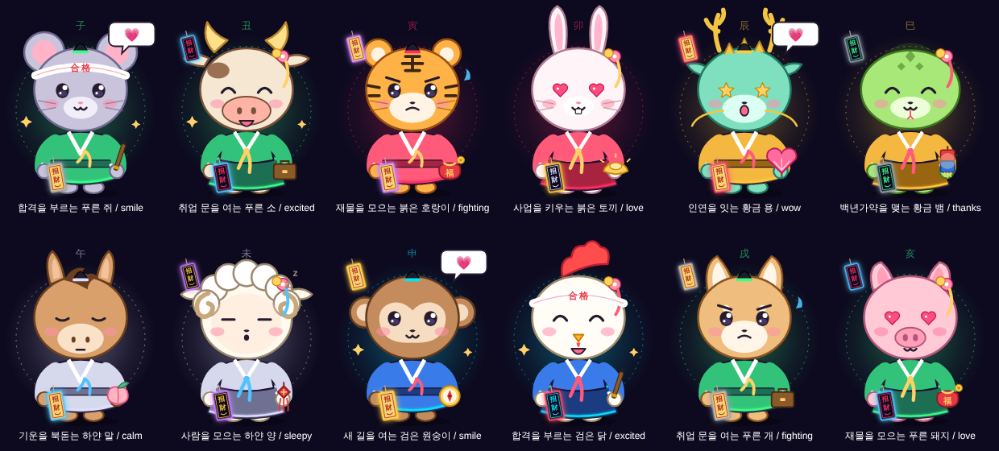

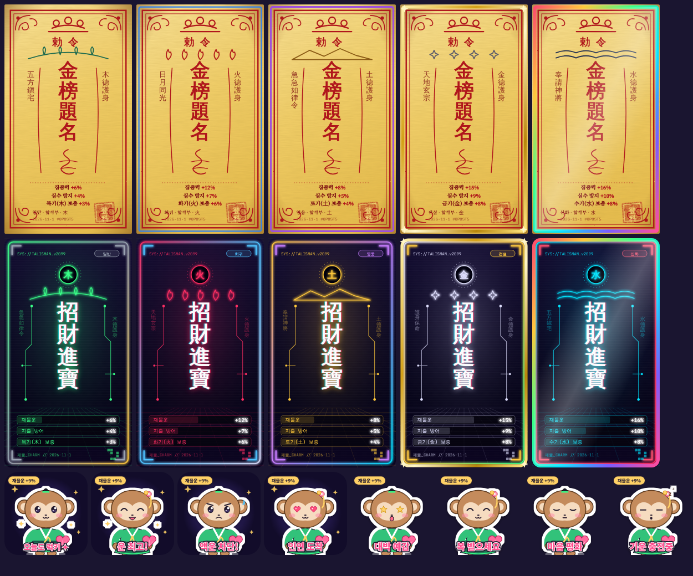

### 진화 5단계

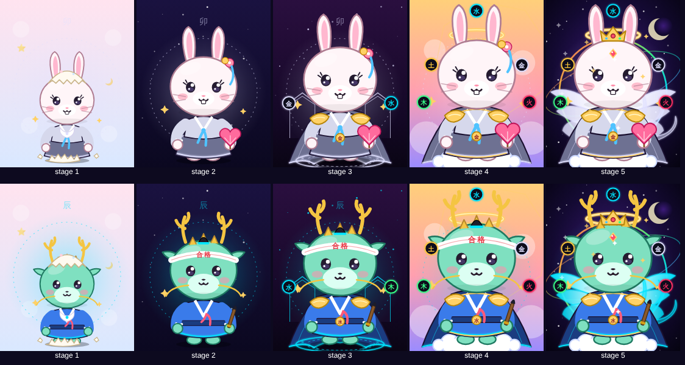

설계 근거와 궁합·꾸미기 상점 분석: [`../docs/growth-monetization-analysis.md`](../docs/growth-monetization-analysis.md)

### 친구 궁합 카드

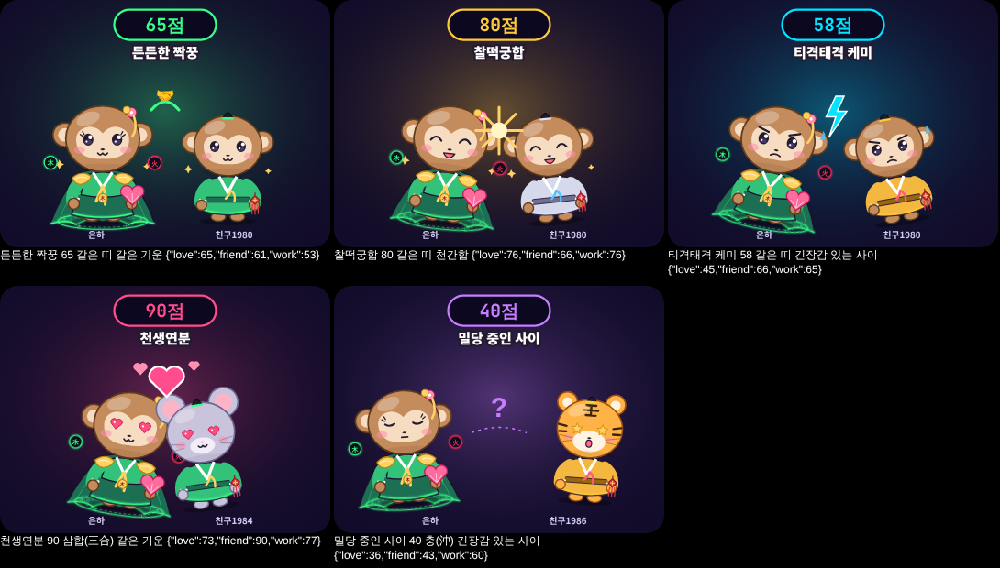

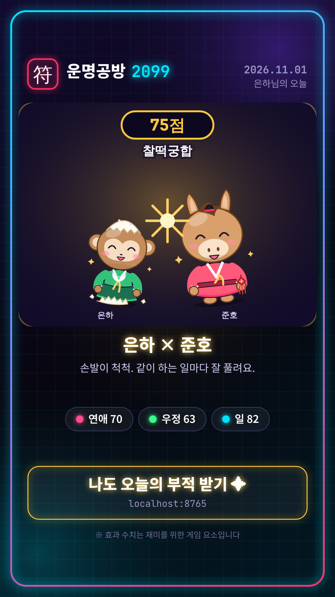

캐릭터 디자인 업그레이드 방향: [`../docs/character-design-upgrade.md`](../docs/character-design-upgrade.md)

### 12띠 성격과 말투

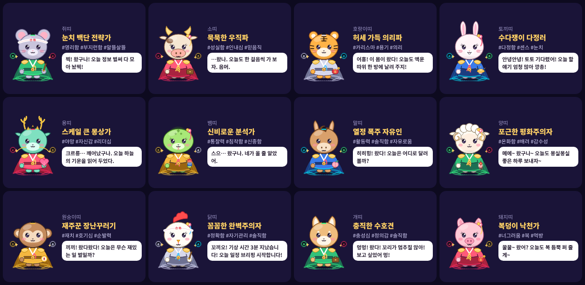
